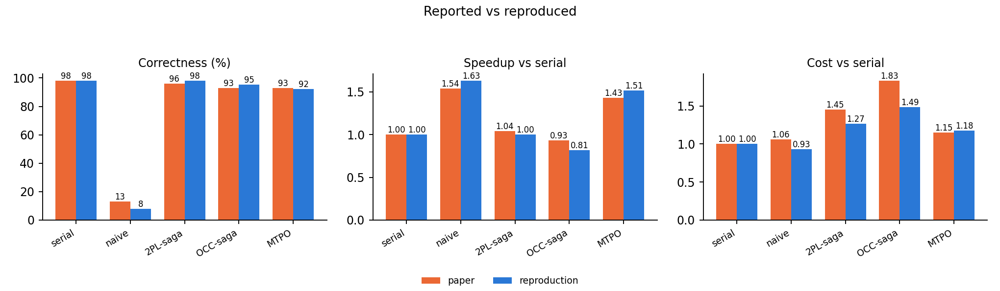

# CoAgent / MTPO — benchmark reproduction

A from-scratch implementation of **MTPO (Monotonic Trajectory Pre-Order)** and
the benchmarks from *CoAgent: Concurrency Control for Multi-Agent Systems*
([arXiv:2606.15376v1](https://arxiv.org/abs/2606.15376), Lyu et al., SJTU,
submitted to ATC 2026). The authors' code is not public — see
[`docs/reproduction-notes.md`](docs/reproduction-notes.md) §1.

Pure Python 3, standard library only (matplotlib just for figures). No API key
and no Kubernetes cluster needed for the default path; the whole matrix runs
in a few seconds.

## Quick start

```bash
python3 scripts/run_matrix.py            # 500 trials: 10 cells x 5 protocols x 10 seeds
python3 scripts/case_study.py --trace    # the canary cell under each protocol (Fig 6)
python3 scripts/livelock.py              # broadcast livelocks, MTPO does not (Fig 2)
python3 scripts/toolsmith_coldstart.py   # online tool-library growth (Fig 7a)
python3 scripts/make_figures.py          # redraw Figure 5 + paper-vs-reproduction
python3 -m unittest discover -s tests    # 32 tests, incl. stress + review regressions
```

## Headline result

2000 trials (10 cells x 5 protocols x 40 seeds). Paper's values in brackets.

| Protocol | Correct | Speedup | Token cost |
|---|---|---|---|
| serial | 98% (98%) | 1.00 (1.00) | 1.00 (1.00) |
| naive | 8% (13%) | 1.63 (1.54) | 0.93 (1.06) |
| 2PL-saga | 98% (96%) | 1.00 (1.04) | 1.27 (1.45) |
| OCC-saga | 95% (93%) | 0.81 (0.93) | 1.49 (1.83) |
| **MTPO** | **92% (93%)** | **1.51 (1.43)** | **1.18 (1.15)** |

Deadlock and abort rates, which were not fitted to anything: 2PL 0.79
deadlocks/trial (paper 0.81), OCC 0.98 aborts/trial (paper 0.95). MTPO's own
invariant — live state equals the sigma-serial state at quiescence — holds in
400/400 trials, across **both** launch orders.



## What MTPO does

Classical CC has two remedies for a conflict — block it (2PL) or discard it
(OCC) — because a transaction cannot heal itself. An LLM agent can: it can
judge whether a conflicting write invalidates a premise, repair only the
operations that depended on it, and emit an inverse for its own writes. So
control becomes advisory and **notification** replaces the lock and the abort.

Each agent gets a serial rank σ at launch. Then three rules:

| Dependency | Rule |
|---|---|
| `wr` | reads **pull**: a read returns `M(o, σⱼ)`, the object's trajectory materialized up to the reader's rank |
| `ww` | writes apply **speculatively in place**; a late write is either shadowed (Thomas rule) or landed by undoing the suffix above it and reapplying it in σ order |
| `rw` | notifications **push**, strictly low-σ → high-σ; the reader re-judges and patches |

One-way flow is what buys termination. `scripts/livelock.py` reproduces the
paper's §5.2 straw-man: with symmetric broadcast, `x ← y/2 ‖ y ← x/2` makes
1076 repairs and walks to `(0, 0)`; MTPO converges in one heal.

## Layout

```
src/coagent/
  core.py           objects, write trajectories, three-phase tools, undo
  runtime.py        toolcall middleware + discrete-event scheduler
  runner.py         trial driver, serial reference oracle
  toolsmith.py      read-only tool-building agent (section 6.4)
  protocols/        serial, naive, 2PL-saga, OCC-saga, MTPO, broadcast
  agents/
    scripted.py     deterministic plans with an explicit premise graph
    llm.py          real Worker over OpenRouter (deepseek-v4-flash)
  workloads/        the ten contended cells + the section 5.2 micro-benchmark
```

## The ten contended cells

Five AIOpsLab-derived and five WorkBench-derived, as in the paper. Each pairs
a task with a partner agent built to race it; a run is correct iff its final
state matches one of the two serial orders, which are derived by actually
running the cell serially both ways rather than hand-transcribed.

| Cell | Suite | Anomaly |
|---|---|---|
| `k8s-canary` | AIOpsLab | rw cycle: stale read + missed range scan |
| `k8s-port-misconfig` | AIOpsLab | phantom insert + stale read |
| `k8s-permission-revoke` | AIOpsLab | phantom insert + stale read |
| `k8s-replica-scale` | AIOpsLab | lost update |
| `k8s-rollback-audit` | AIOpsLab | non-idempotent append + stale premise |
| `wb-crm-dedupe` | WorkBench | phantom insert + stale read |
| `wb-calendar-doublebook` | WorkBench | lost update |
| `wb-email-triage` | WorkBench | non-idempotent append + stale premise |
| `wb-analytics-restate` | WorkBench | phantom insert + stale read |
| `wb-project-rebalance` | WorkBench | lost update |

`k8s-canary` is the paper's own example and is faithful to §2.2/§7.3. **The
other nine are reconstructed** — the paper does not publish its pairs. Read
`docs/reproduction-notes.md` §3 before quoting any number from here.

## Running against a real model

All ten cells carry a natural-language task per agent and a tool catalog
(`Cell.llm_spec`), so the full matrix runs against a real model. Only the
decision-maker swaps — the target system and the invariants are unchanged.
Two providers:

| Provider | Model | What it measures |
|---|---|---|
| `openrouter` | `deepseek-v4-flash` | the paper's own setup — does their 5% A3 miss rate replicate |
| `anthropic` | `claude-opus-5` (default), or `--model claude-haiku-4-5` | a *different* model's self-healing rate — does MTPO's correctness claim hold on a frontier model |

These are different experiments. Only the first is a reproduction.

```bash
cp .env.example .env && $EDITOR .env        # OPENROUTER_API_KEY / ANTHROPIC_API_KEY

python3 scripts/run_llm_matrix.py --dry-run --cells all --protocols all --trials 10
.venv/bin/python scripts/run_llm_matrix.py --provider anthropic --cells k8s-canary --trials 5
```

Cost for the full 500-trial matrix at list price:

| Model | Estimate |
|---|---|
| `deepseek-v4-flash` | **$2.05** |
| `claude-haiku-4-5` | $26 |
| `claude-opus-5` | $131 |

Anthropic runs use adaptive thinking by default — judging whether a
notification invalidates a premise is precisely the reasoning under
measurement, so suppressing it would measure the wrong thing. Thinking tokens
bill as output and are *not* in those estimates; `--effort low` or
`--no-thinking` trade depth for spend.

Runs append to `results/llm_runs.jsonl` and are resumable; `--dry-run` prices
a run without calling anything, and the script refuses to start without a key
rather than failing midway. The summary prints the measured A3 miss rate next
to the paper's 5%.

The Anthropic path needs the SDK: `.venv/bin/pip install anthropic` (a venv
is already set up; the core stays standard-library only).

Reproducing §7.4's pass rates additionally needs a live `kind` cluster — see
reproduction notes §7.

## Adversarial review

The implementation was reviewed adversarially after the first results were
produced; the review found nine real defects, each with a reproduction.
`tests/test_review_regressions.py` pins every one. Three changed published
numbers, and the table above is the corrected run:

| Defect | Effect |
|---|---|
| Thomas write rule applied at object granularity while every blind tool is field-granular | a late write to `replicas` was silently dropped because a write to `image` sat above it — invariant false in 330/800 randomized trials |
| Saga undo snapshot-restored the whole object | an OCC loser's abort destroyed the winner's committed write; **OCC's correctness was understated at 91%, actually 95%** |
| `p_task_failure` re-rolled on every restart | abort-heavy protocols absorbed more individual failures than MTPO at the same nominal rate — **biased 2PL and OCC down** |
| `expand`-generated plan steps were never repairable | sweep agents could not self-heal; masked because the sweep agent always got σ=0 |
| Launch order pinned to `[0, 1]` | hid the above, and made the same agent the deadlock victim in every trial |
| Premise refresh dropped *all* the reader's own writes | broke read-your-own-writes; now keyed on the read's position |
| Reorder path and rw push both notified the same reader | double-billed context and consumed two judgement rolls per event |
| `str.startswith` object matching | `geo-canary` treated as a child of `geo`, corrupting a point premise |
| Deadlock detection required *every* agent blocked | a real 2-agent cycle went undetected whenever a third agent had finished |
| Reading a missing object materialized a `None` phantom | range reads saw it, making the correctness oracle protocol-dependent |

The headline MTPO numbers moved little, but they are now measured against
both σ orders and a sound OCC baseline.

## The redo model

A real run against `claude-haiku-4-5` exposed the simulation's weakest
assumption: **that a restart reproduces the original execution.** A scripted
agent replays its plan perfectly after an abort; a real one restarts with a
cleared context and produces a worse run. Measured across 20 real abort
events, an aborted agent loses ~15 points of task completeness.

`--redo-truncate` models it. The cost scales with how much work the victim had
done, so it lands on OCC (which victimises the multi-write sweep agent) and
not on 2PL (whose victim here has a single write) or MTPO (which never
aborts):

| Protocol | perfect redo (default) | lossy redo (0.22) |
|---|---|---|
| 2PL-saga | 98% | 91% |
| OCC-saga | 95% | 86% |
| **MTPO** | **92%** | **92%** |

It defaults to **0**, because the rest of the configuration is calibrated to
the paper's model, whose 98% serial baseline implies it also redoes well —
importing a weak-model number into a strong-model calibration would mix two
agents. The takeaway stands either way: **the weaker the agent, the worse
abort-based concurrency control gets, and MTPO is unaffected.**

## Real LLM Workers: the A3 assumption, measured

One run so far — `claude-haiku-4-5`, canary cell, 10 trials per protocol,
$1.48 (`results/llm_runs.jsonl`, `results/figures/llm_canary.png`).

| protocol | anomaly-free | overall correct |
|---|---|---|
| serial | 10/10 | 5/10 |
| naive | 6/10 | 6/10 |
| 2PL-saga | 10/10 | 6/10 |
| OCC-saga | 5/10 | 4/10 |
| **MTPO** | **10/10** | 5/10 |

Overall correctness is noise: Haiku fails its *own* task ~half the time (A1 ≈
50% vs the paper's 98%), uniformly across protocols. Conditioning on the
anomaly the cell tests separates them cleanly — of 24 failures, only 9 are
genuine concurrency failures and all 9 are under naive or OCC.

**A3 self-healing, measured rather than assumed: 10/10.** Every notified agent
recognised the premise conflict and repaired. The paper assumes 95%.

## Caveats

Short version: the protocol is faithful, nine of ten workloads are
reconstructed, four parameters are calibrated against four reported
statistics, and wall-clock is virtual. `docs/reproduction-notes.md` has the
full accounting, including what this reproduction *cannot* establish.
